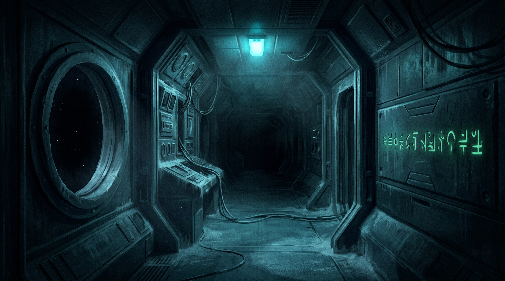

# Il Relitto Silente



**Avventura testuale di fantascienza, in italiano.** Sei a bordo della *Santa Maria*, una nave da carico, davanti a un relitto alieno che non dovrebbe essere lì, silenzioso. Ventitré stanze, novantatré oggetti, sei finali. Si gioca a pulsanti, con il mouse o con la tastiera; chi preferisce l’avventura testuale classica può scrivere i comandi (nelle opzioni, «Comandi: scritti»).

Questo è il **remake desktop** del gioco: la storia è scritta in [Favella1](https://github.com/Pitz72/FAVELLA1), il linguaggio per avventure testuali dello stesso autore, e l’app è fatta con Tauri.

> **Stato: in sviluppo, non ancora rilasciato.** Le versioni di sviluppo sono le 0.x (il numero di oggi è in [`versione.json`](versione.json), le novità nel [registro delle modifiche](CHANGELOG.md)); il primo rilascio pubblico sarà la **1.0.0**. Per ora si gioca compilando da sorgente (vedi sotto). Le release che trovi nella pagina «Releases» sono quelle della **versione originale** (vedi la prossima sezione).

## Due giochi in un repository

| | Che cos’è | Dove sta | Numeri di versione |
|---|---|---|---|
| **Il remake** | Il gioco di oggi: Favella1 dentro un’app Tauri, con musica e suoni nuovi | questa cartella | 0.x in sviluppo, poi 1.0.0 |
| **La versione originale** | Il primo Relitto Silente (Electron e React), tutto com’era | [`old_version/`](old_version/), con la sua storia e i suoi tag | 1.x (`v1.2.6`, `v1.5.1`, `v1.5.3`) |

Sono due programmi diversi, con due sviluppi diversi: **la numerazione del remake comincia da capo**. Il vecchio gioco si recupera sempre: `git checkout v1.5.3`, oppure il tag `old-version-final`.

## Che cosa c’è dentro

- **Il gioco**: `relitto-silente/`, quattordici file `.fav`, uno per atto più i trasversali. Il motore che lo fa girare è Favella1 (`motore/`), che gira nell’app dentro Pyodide.
- **L’app**: `app/`, Tauri 2 con React e TypeScript, e un motore audio in Rust. Un’interfaccia fatta apposta: la lamina del testo, il ramo e il fiore delle azioni, il diario, i salvataggi su disco.
- **Il suono** è tutto sintetizzato dal codice (stanze, eventi, voci del brusio, il Sintonizzatore). **La musica** è generata con intelligenza artificiale (vedi sotto).
- **Le prove**: `collaudo/` gioca ogni finale e controlla che il gioco resti vincibile; `app/prove/` prova l’interfaccia.
- **I documenti di progetto**: `progettazione/`, in italiano: come è fatto, perché, e che cosa si è deciso.

Chi vuole sapere dove sta ogni cosa trova la mappa completa e tutti i comandi in [`sviluppo/STRUTTURA.md`](sviluppo/STRUTTURA.md).

## Compilare ed eseguire

Servono Node 22 e Rust (per l’eseguibile), Python 3.10 o più recente per le prove.

```bash
npm --prefix app install
npm --prefix app run dev
```

Poi apri `http://localhost:5274/`. Per costruire l’eseguibile:

```bash
npm --prefix app run tauri build
```

Windows è la piattaforma provata; su Linux si costruiscono `.deb` e AppImage, ma manca ancora la prova su una macchina vera.

## Licenza

Due licenze, scelte dall’autore: **MIT per il codice**, **CC BY-NC-SA 4.0 per la storia, i testi, le immagini e la musica**. Come si dividono le cartelle, le dipendenze di terzi e le note sull’intelligenza artificiale sono in [`LICENZE.md`](LICENZE.md).

## Intelligenza artificiale

Per essere chiari: **la musica** è generata con **Lyria 3.5** (Google Flow Music) e con **Suno**, su indicazione dell’autore, ed è elencata brano per brano in [`audio/musica-ia/REGISTRO.md`](audio/musica-ia/REGISTRO.md); **alcune immagini** sono generate con strumenti di IA (registro in [`grafica/LICENZE.md`](grafica/LICENZE.md)); **il codice e i documenti** sono stati scritti dall’autore con l’aiuto di Claude (Anthropic). La storia e i personaggi sono dell’autore.

## Autore

**Simone Pizzi** — © 2026. Il remake fa parte della famiglia dei progetti Runtime Multimedia.
