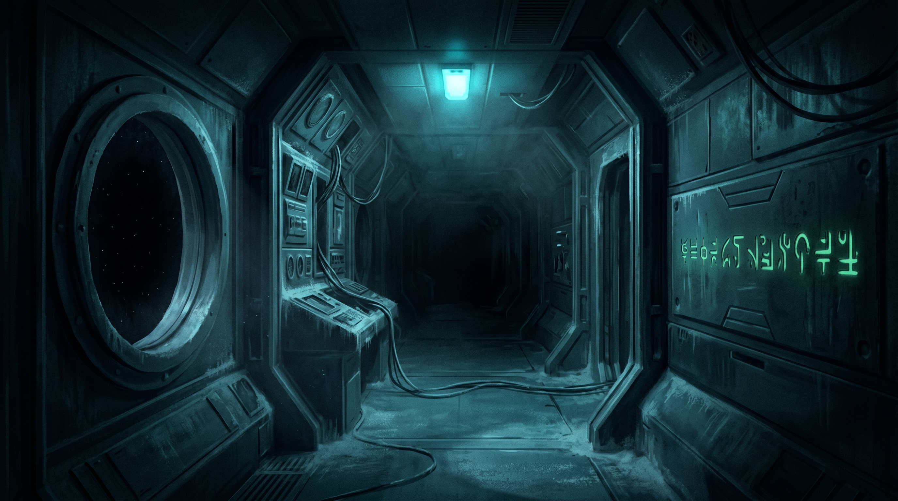

# Il Relitto Silente



**Avventura testuale di fantascienza, in italiano.** Sei a bordo della *Santa Maria*, una nave da carico, davanti a un relitto alieno che non dovrebbe essere lì, silenzioso. Ventitré stanze, novantatré oggetti, sei finali. Si gioca a pulsanti, con il mouse o con la tastiera; chi preferisce l’avventura testuale classica può scrivere i comandi (nelle opzioni, «Comandi: scritti»).

Questo è il **remake desktop** del gioco: la storia è scritta in [Favella1](https://github.com/Pitz72/FAVELLA1), il linguaggio per avventure testuali dello stesso autore, e l’app è fatta con Tauri.

> **Stato: in sviluppo.** C’è una **demo dell’atto I** da scaricare e giocare, per Windows e per Linux: [la demo](https://github.com/Pitz72/il-relitto-silente-opensource/releases/tag/demo-atto-1) (21 novembre 2026). Le versioni di sviluppo sono le 0.x (il numero di oggi è in [`versione.json`](versione.json), le novità nel [registro delle modifiche](CHANGELOG.md)) e escono come **pre-release** di prova; il primo rilascio pubblico del gioco intero sarà la **1.0.0**. Nella pagina «Releases» trovi tre cose: la demo, le pre-release del remake (`v0.2.5-beta.N`) e le release della **versione originale** (`v1.x`, vedi la prossima sezione), che GitHub segna ancora come «Latest».

## Due giochi in un repository

| | Che cos’è | Dove sta | Numeri di versione |
|---|---|---|---|
| **Il remake** | Il gioco di oggi: Favella1 dentro un’app Tauri, con musica e suoni nuovi | questa cartella | 0.x in sviluppo, poi 1.0.0 |
| **La versione originale** | Il primo Relitto Silente (Electron e React), tutto com’era nella storia del repository, con i suoi tag (non più nel ramo principale dal 25 novembre 2026) | 1.x (`v1.2.6`, `v1.5.1`, `v1.5.3`) |

Sono due programmi diversi, con due sviluppi diversi: **la numerazione del remake comincia da capo**. Il vecchio gioco si recupera sempre: `git checkout v1.5.3`, oppure il tag `old-version-final`.

## Che cosa c’è dentro

- **Il gioco**: `relitto-silente/`, quattordici file `.fav`, uno per atto più i trasversali. Il motore che lo fa girare è Favella1 (`motore/`), che gira nell’app dentro Pyodide.
- **L’app**: `app/`, Tauri 2 con React e TypeScript, e un motore audio in Rust. Un’interfaccia fatta apposta: la lamina del testo, il ramo e il fiore delle azioni, il diario, i salvataggi su disco.
- **Il suono** del mondo è sintetizzato dal motore audio (le stanze, le macchine, gli eventi, il Sintonizzatore). **Le voci** sono registrate o generate: William ha la voce di Leonardo Tomassetti; le altre sono generate (vedi sotto). **La musica** è generata con intelligenza artificiale, tranne il tema dell’intro, che è di Alirio Bruni.
- **Le prove**: `collaudo/` gioca ogni finale e controlla che il gioco resti vincibile; `app/prove/` prova l’interfaccia.
- **I documenti di progetto**: `progettazione/`, in italiano: come è fatto, perché, e che cosa si è deciso.

Chi vuole sapere dove sta ogni cosa trova la mappa completa e tutti i comandi in [`sviluppo/STRUTTURA.md`](sviluppo/STRUTTURA.md).

## Compilare ed eseguire

Servono Node 22 e Rust (per l’eseguibile), Python 3.10 o più recente per le prove.

```bash
npm --prefix app install
npm --prefix app run dev
```

Poi apri `http://localhost:5274/`. Per costruire l’eseguibile:

```bash
npm --prefix app run tauri build
```

Windows è la piattaforma provata; su Linux si costruiscono `.deb` e AppImage, ma manca ancora la prova su una macchina vera.

## Licenza

> **Nota del 31 ottobre 2026.** La licenza con cui verrà distribuito il gioco 1.0 è ancora in definizione. Le versioni già pubblicate, fino alla 0.2.5-beta.15 e alla demo dell’atto I, restano come dichiarato qui sotto.

Due licenze, scelte dall’autore: **MIT per il codice**, **CC BY-NC-SA 4.0 per la storia, i testi, le immagini e la musica**. Due cose stanno fuori: **la voce di William**, che è dell’attore, e **il tema dell’intro**, che è di Alirio Bruni. Come si dividono le cartelle, le dipendenze di terzi e le note sull’intelligenza artificiale sono in [`LICENZE.md`](LICENZE.md).

## Intelligenza artificiale

Per essere chiari, con le stesse parole che il gioco dice all’avvio:

- **Il gioco** è stato sviluppato con l’ausilio dell’intelligenza artificiale dei modelli Claude (Anthropic), ma è il frutto di una progettazione metodica e accurata del suo autore. La storia e i personaggi sono dell’autore.
- **La musica** è stata generata con l’intelligenza artificiale (**Lyria 3.5** di Google, **Suno** ed **ElevenLabs**), scelta e diretta dall’autore; è elencata brano per brano in [`audio/musica-ia/REGISTRO.md`](audio/musica-ia/REGISTRO.md). Il tema dell’intro, **«The Santa Maria Theme»**, è di **Alirio Bruni**: non è musica generata.
- **Le voci.** La voce di L.V. e quella di servizio (la tuta, i suggerimenti, il computer di bordo) sono state generate con la sintesi vocale di Google; quelle dell’Anziano, di Yusuf (la voce dell’autore, clonata) e delle voci della nave con ElevenLabs. **William** ha la voce di **Leonardo Tomassetti**: una persona vera, che lo sta registrando. Il registro è in [`audio/LICENZE.md`](audio/LICENZE.md).
- **Ogni altro suono** è sintetizzato dal motore audio del gioco.
- **Alcune immagini** (la plancia, la cuccetta, la stiva, la sala macchine, il ritratto di Yusuf) vengono dagli asset del seguito, *Il mistero della Santa Maria*, generati dall’autore con strumenti di IA; le copertine, la nave e il relitto sono disegnati o resi dal codice (registro in [`grafica/LICENZE.md`](grafica/LICENZE.md)).

## Autore

**Simone Pizzi** — © 2026. Il remake fa parte della famiglia dei progetti Runtime Multimedia.
